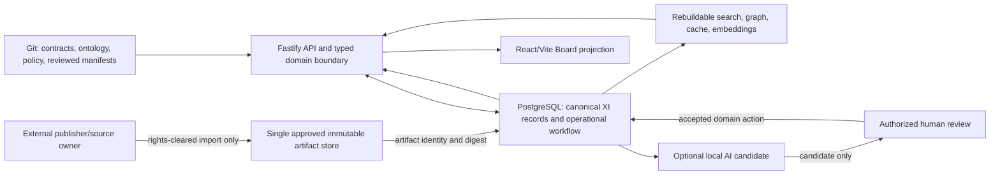

# Knowledge domain ownership and data flow

- Status: design baseline accepted under [ADR 0004](../decisions/0004-knowledge-rebuild-centralization.md)
- Scope: K0-003; architecture proposal only, with no runtime or schema changes
- Source plan: `MOONWITNESS_XI_LOCAL_AI_REBUILD_PLAN_2026-10-15/MOONWITNESS_XI_MASTER_PLAN.md`

This page assigns one canonical owner to each class of information. It does not
select a new database schema, addon, package, object store, or corpus license.
The accepted runtime remains Fastify, Objection/Knex, PostgreSQL, React/Vite,
and programmatic addon installation.

## Ownership matrix

| Information class                                                                                                                                                           | Canonical owner                                                                                                       | Derived or referenced copies                                                                                             | Boundary                                                                                                                                                           |
| --------------------------------------------------------------------------------------------------------------------------------------------------------------------------- | --------------------------------------------------------------------------------------------------------------------- | ------------------------------------------------------------------------------------------------------------------------ | ------------------------------------------------------------------------------------------------------------------------------------------------------------------ |
| XI source code, contract definitions, ontology vocabulary, policies, ingestion recipes, reviewed public release manifests                                                   | Git in this repository                                                                                                | Built packages, documentation, generated API references                                                                  | Changes are reviewed code/data changes on `dev`, promoted through the existing protected `dev` → `main` process.                                                   |
| Original third-party work and its rights statement                                                                                                                          | The identified publisher/rightsholder and edition                                                                     | XI provenance metadata may identify source, edition, locator, rights evidence, and digest                                | XI does not become the authority for the source work or its license. Unknown rights mean no redistributed bytes. Rights approval and takedown handling are K0-004. |
| Imported source artifact bytes for an accepted dataset release                                                                                                              | One explicitly selected immutable artifact location per release; location must be recorded in its release manifest    | Checksums, locators, and derived normalized/search representations                                                       | Do not keep two writable/canonical copies. The byte store and rights must be selected and reviewed before ingestion; this page does not select it.                 |
| Operational canonical records: source metadata, stable XI IDs/aliases, passages, assertions, typed relations, evidence links, provenance, corrections, and review decisions | PostgreSQL through an approved XI programmatic addon boundary, if/when that design is separately accepted             | API responses, Board state, exports, search documents, and graph materializations                                        | No live schema is approved by this page. Preserve record revision, origin, rights, visibility, and review state.                                                   |
| Operational binary assets such as witness attachments or media                                                                                                              | One approved object-storage object per immutable asset version                                                        | PostgreSQL stores the owner, access/classification metadata, object locator, checksum, and version; previews are derived | Database metadata does not duplicate the asset bytes as a second canonical copy. Storage security, retention, and malware controls require their own design.       |
| Private witness and account-export originals, if ever consented                                                                                                             | Restricted XI operational storage: PostgreSQL for structured record, approved object storage for binary originals     | Redacted projections and indexes only when separately authorized                                                         | Private by default. No import is authorized here; consent, deletion/redaction, retention, and child-safety gates remain K0-005.                                    |
| Task execution, review workflow, permissions, audit events, and operational job/outbox state                                                                                | Existing PostgreSQL-backed XI application/workflow records                                                            | Logs and reports are limited projections with secrets and sensitive content scrubbed                                     | Use existing auth, tenant boundaries, and addon contracts. Application audit is append-only behavior, not tamper-proof against database operators.                 |
| Search index, embeddings, graph adjacency, caches, compiled UI/docs, and analytics projections                                                                              | No independent canonical owner; reproducible outputs are owned by their source record plus a pinned transform/version | Rebuildable derived stores and files                                                                                     | May be deleted and recreated. Never resolve identity, rights, or truth from these outputs alone.                                                                   |
| Local AI prompts/results and candidate suggestions                                                                                                                          | Candidate workflow record in the operational store, until accepted by a human through the owning domain workflow      | Temporary process memory and scrubbed diagnostics                                                                        | Local AI is optional and disabled by default. Candidate output cannot directly mutate canonical knowledge or publish. No remote fallback.                          |
| Historical repositories and unreconciled designs                                                                                                                            | The original repository/source owner                                                                                  | XI may later keep reviewed provenance and a migration/reconciliation decision                                            | Reference-only unless a specific item passes K0-004 rights and K0-006 source/identity review. Never a runtime dependency.                                          |

## Data flow

The diagram shows proposed boundaries, not a newly implemented ingestion
pipeline. An imported source keeps its publisher/edition provenance and exact
artifact digest. A derived index is disposable. Human review remains an
explicit transition before a candidate becomes a domain record or a publication
projection.

## Reconciliation notes and open decisions

- **Git versus PostgreSQL:** Git owns reviewed definitions and release
  manifests; PostgreSQL owns operational records, edits, reviews, and workflow
  state. Do not maintain a second editable registry in Board or AI memory.
- **Object bytes versus database metadata:** each binary object has one byte
  owner. PostgreSQL may store its locator, version, digest, access, and
  provenance metadata without becoming a second byte store.
- **Corpus bytes and rights:** no edition, license, artifact store, or public
  redistribution permission is established by the plan or this matrix. K0-004
  must define accepted metadata-only behavior and rights evidence before an
  ingestion task.
- **Current XI ORM representation:** accepted ADR 0001 restricts schema/seed
  changes to the programmatic addon/upgrade path and existing declarative field
  kinds are bounded. A knowledge model that cannot be faithfully represented
  needs a separate typed adapter ADR and compatibility evidence; do not add a
  generic JSON/graph table by assumption.
- **Privacy and child safety:** public projections cannot lower inherited
  classification. K0-005 must define consent, retention, deletion/redaction,
  and child-protection controls before any real private import or public
  projection.
- **Legacy inventory:** no legacy source checkout was available in the bounded
  sibling inspection. Missing sources, licenses, IDs, and historical metrics
  remain `MISSING` until actual files and rights evidence are supplied or
  inspected.
- **Runtime AI and external calls:** no hosted LLM, hidden remote fallback, or
  retrieved-text authority is permitted. Egress restrictions still need an
  operational proof before offline certification.

## Acceptance record

- Each listed data class has one named owner or is explicitly recorded as an
  external/source owner, candidate-only, or reproducible derived output.
- Board/API outputs and indexes are projections; none is a second canonical
  registry.
- Storage, rights, privacy, schema, and AI decisions that lack evidence remain
  open gates rather than implied implementations.
